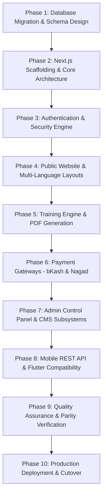

# MIGRATION ROADMAP & ENGINEERING EXECUTION PLAN

This document defines the complete, phased engineering blueprint for migrating the **জমঈয়ত শুব্বানে আহলে হাদীস বাংলাদেশ (Shubban)** web platform from Laravel/MySQL to Next.js 15+ (App Router, TypeScript) and PostgreSQL 16+.

---

## 1. Architectural Strategy & Ground Rules

1. **Isolation Rule**: The existing Laravel directory (`Shubban-02`) remains 100% read-only and untouched. The Next.js application will be scaffolded in a distinct directory (e.g. `../shubban-nextjs` or dedicated workspace).
2. **Feature & Visual Parity Rule**: 100% of all public user interfaces, administrative CMS modules, digital payment handshakes, and mobile API endpoints will be migrated without feature omission.
3. **Data Integrity Rule**: Zero data loss from `weekbieb_final_shubban.sql`. All foreign keys, multilingual translations, and historical timestamps will be preserved.
4. **Mobile Client Backward Compatibility**: The Flutter application in `mobile_app/` must continue communicating with the API without requiring client-side Dart code changes.

---

## 2. Phased Migration Execution Phases

---

### Phase 1: Database Migration & Schema Setup
* **Objective**: Establish PostgreSQL database, create optimized schema with Prisma ORM, and migrate existing MySQL data.
* **Key Tasks**:
  1. Provision PostgreSQL 16+ database instance.
  2. Implement `schema.prisma` with models for all 33 tables, converting types (`TINYINT` -> `BOOLEAN`, `JSON valid` -> `JSONB`, `DATETIME` -> `TIMESTAMPTZ`, identity sequences).
  3. Resolve legacy schema bugs:
     * Standardize `managements` table status column and map legacy `responsibles` data.
     * Consolidate `gallery_archives` into `archives` with foreign key relations to `photos`.
  4. Write automated Node.js ETL migration script to parse `weekbieb_final_shubban.sql`, sanitize datetime values, transform JSON structures, and insert records.
  5. Reset PostgreSQL identity sequences for all tables.
  6. Verify row count parity across all 33 tables.

---

### Phase 2: Next.js Scaffolding & Core Architecture
* **Objective**: Initialize high-performance Next.js 15+ full-stack foundation.
* **Key Tasks**:
  1. Initialize Next.js 15+ with TypeScript, App Router, React 19, and Tailwind CSS v4.
  2. Configure shadcn/ui component primitives and Lucide React icon set.
  3. Setup multi-language routing with `next-intl` supporting `bn` (default), `en`, and `ar`.
  4. Implement bi-directional layout support (`dir="ltr"` vs `dir="rtl"` with `bootstrap.rtl` replacement utilities).
  5. Configure font loaders for `Noto Sans Bengali` and `Noto Sans Arabic`.
  6. Setup database client singleton (`prisma` or `drizzle`).

---

### Phase 3: Authentication & Security Engine
* **Objective**: Implement secure authentication for Admin Panel and Mobile API.
* **Key Tasks**:
  1. Setup **Auth.js v5 (NextAuth)** with Credentials Provider for Admin session authentication.
  2. Configure Bcrypt password verification compatible with existing Laravel `$2y$` hashes.
  3. Build Next.js `middleware.ts` to protect `/admin/*` routes, redirecting unauthenticated requests to `/admin/login`.
  4. Implement stateless JWT Bearer token generator and validator for mobile API routes (`/api/v1/*`).
  5. Configure CSRF token protection on Server Actions and rate limiting on authentication routes.

---

### Phase 4: Public Website & Multi-Language Layouts
* **Objective**: Build all public web pages with 100% visual and functional parity.
* **Key Tasks**:
  1. **Layout**: Header (top contact bar, logo, search, language switcher, mega-dropdown), Footer (newsletter, contact info, quick links).
  2. **Home Page**: Hero carousel with auto-play, notice marquee ticker, news cards, photo highlights, video embeds, archive showcase, and recent activities.
  3. **About & Facilities**: History, Introduction, Mission, Goals, Research Center, Shekor, As-Shifa, Maktabah.
  4. **Central Office & Hierarchy**: Central Committee, Departments, Officials, Multi-tier leadership (District, Upazila, Thana, Branch).
  5. **Publications**:
     * Books Catalog, search, pagination, and embedded PDF.js reader.
     * Magazines Catalog with featured latest issue, details, and PDF.js reader.
     * Research Articles list and full reading view with related suggestions.
  6. **News & Notices**:
     * News list, article details, IP-based like/unlike toggle, visitor comment form.
     * Notice board with category filters, monthly archive tree, and PDF download.
  7. **Media & Gallery**: Photos with category filters, YouTube video gallery, and annual photo archive albums.
  8. **Contact Us**: Contact form submission with validation and Google Map embed.

---

### Phase 5: Training Engine & PDF Generation
* **Objective**: Rebuild the specialized training registration and dynamic admit slip generator.
* **Key Tasks**:
  1. Build public admission pages for courses: Aref, Rageb, Salek, and Saleh.
  2. Implement registration form with React Hook Form and Zod:
     * 11-digit Bangladeshi mobile validation (`01[3-9]\d{8}`).
     * NID format validation (10, 13, 17 digits).
     * Date of birth restriction (`before:today`).
     * "Same as Present Address" auto-mirroring checkbox.
     * Applicant photograph upload (2MB limit).
  3. Implement Server Action with duplicate registration check (`mobile` or `name + father + mother` per course).
  4. Implement PDF generation engine (using Puppeteer or `@react-pdf/renderer`) with embedded `SolaimanLipi` / `Nikosh` TrueType fonts.
  5. Implement PDF download (`/api/training/download/[id]`) and print stream (`/api/training/print/[id]`).

---

### Phase 6: Digital Payment Gateways (bKash & Nagad)
* **Objective**: Rebuild digital donation processing with tokenized and cryptographic integrations.
* **Key Tasks**:
  1. Build donation portal with cause selection (`orphan`, `student`, `ramadan`, `eid`, `quran`, `general`) and amount presets.
  2. **bKash Tokenized Checkout**:
     * Implement `BkashService` in TypeScript.
     * Token grant, payment create, execute, and status query.
  3. **Nagad Cryptographic Checkout**:
     * Implement `NagadService` in Node.js using native `crypto` module.
     * 2048-bit RSA encryption with Nagad public key and SHA-256 signing with private key.
     * Decrypt callback transaction reference and verify success.
  4. **Manual Banking Verification**:
     * Form for submitting Transaction ID (TrxID) for bKash, Nagad, Rocket, and Bank transfers.
  5. Build `/donate/success` and `/donate/failed` status confirmation pages.

---

### Phase 7: Administrative CMS & Control Panel
* **Objective**: Rebuild the 15+ administrative management subsystems in `/admin/*`.
* **Key Tasks**:
  1. **Dashboard**: 10 KPI metric cards (Sliders, Members, Management tiers, Donations collected, Unread contacts, News, Notices, Activities, Gallery, Publications) and recent activities table.
  2. **Sliders CMS**: CRUD with image upload and display ordering.
  3. **Committee CMS**: Central committee member management.
  4. **Management CMS**: Multi-tier management (Central, District, Upazila, Thana, Branch) with 300x300 image cropping via `sharp`.
  5. **Departments & Officials CMS**: Form management with JSON array tags for responsibilities and expertise.
  6. **Publications CMS**: Books, Magazines, and Articles management with TipTap/TinyMCE WYSIWYG editor and image upload endpoint.
  7. **News & Comments Moderation**: News CRUD and comment approval queue.
  8. **Notices & Activities CMS**: Circular document uploads and event activities.
  9. **Donations Ledger**: Review incoming donations, filter by status, and approve/reject transactions.
  10. **Training Applicants CMS**:
      * Applicant rosters for Aref, Rageb, Salek, and Saleh.
      * Individual applicant PDF download.
      * **Consolidated Roster PDF Export (`download-all`)**: Multi-page PDF list of all admitted students with Bengali typography.
  11. **Media CMS**: Galleries, Archives, Photos, and Videos.
  12. **System Settings & Profile**: General site info, logo upload, social links, and admin password change.

---

### Phase 8: Mobile REST API & Cross-Platform Compatibility
* **Objective**: Ensure 100% API compatibility with the Flutter mobile application in `mobile_app/`.
* **Key Tasks**:
  1. Build Route Handlers under `/api/v1/*` matching Laravel Sanctum payload formats.
  2. Implement `/api/v1/auth/login`, `/register`, `/logout`, `/user`, `/user/update`.
  3. Implement `/api/v1/products` and `/api/v1/products/[id]`.
  4. Implement `/api/v1/news` and `/api/v1/news/[id]`.
  5. Implement Firebase Cloud Messaging (FCM) push notification dispatcher using `firebase-admin`.
  6. Run Flutter mobile app in test environment pointing to Next.js API server to verify authentication and data feeds.

---

### Phase 9: Quality Assurance & Parity Verification
* **Objective**: Verify 100% visual, functional, and performance parity.
* **Key Tasks**:
  1. **Visual Parity**: Side-by-side comparison of all 25+ public page types across desktop, tablet, and mobile breakpoints.
  2. **Bi-Directional RTL Verification**: Verify Arabic layout mirroring, navigation, and typography.
  3. **Form & Validation Testing**: Test boundary cases on Training registration, Donation checkout, and Contact form.
  4. **PDF Output Verification**: Ensure zero Bengali font distortion, broken ligatures, or overlap in admit slips and attendance rosters.
  5. **Security Audit**: Penetration testing for SQL injection, XSS in article content, CSRF, and unauthorized admin route access.
  6. **Performance Benchmarking**: Target Lighthouse score of 95+ (Performance, Accessibility, Best Practices, SEO).

---

### Phase 10: Production Deployment & Cutover
* **Objective**: Production release with zero downtime.
* **Key Tasks**:
  1. Setup production PostgreSQL database with automated backups and connection pooling (PgBouncer).
  2. Containerize Next.js application using Docker multi-stage build.
  3. Deploy Next.js to production infrastructure (Vercel, AWS ECS, or Ubuntu VPS with PM2/Docker).
  4. Migrate all physical media assets (`storage/app/public/` and `public/uploads/`).
  5. Execute final data sync from MySQL to PostgreSQL.
  6. Update DNS A/CNAME records to point traffic to the Next.js server.
  7. Post-cutover monitoring of error logs, payment gateway callbacks, and mobile API requests.
