# MODEL RELATIONSHIPS & ORM ARCHITECTURE SPECIFICATION

This document details all 30 Laravel Eloquent Models, their database relationships, attribute casts, accessors, scopes, and provides the equivalent schema definition for Prisma ORM / PostgreSQL.

---

## 1. Visual Entity-Relationship Diagram (Mermaid ERD)

```mermaid
erDiagram
    NEWS ||--o{ NEWS_COMMENTS : "has many"
    NEWS ||--o{ NEWS_LIKES : "has many"
    ARCHIVES ||--o{ PHOTOS : "has many"
    USERS ||--o{ PERSONAL_ACCESS_TOKENS : "has many"

    USERS {
        bigint id PK
        string name
        string email UK
        string password
        text fcm_token
        timestamp created_at
    }

    ADMINS {
        bigint id PK
        string name
        string email UK
        string password
        boolean status
        timestamp created_at
    }

    NEWS {
        bigint id PK
        string title
        text description
        string image
        boolean status
        timestamp created_at
    }

    NEWS_COMMENTS {
        bigint id PK
        bigint news_id FK
        string name
        string email
        text comment
        boolean status
        timestamp created_at
    }

    NEWS_LIKES {
        bigint id PK
        bigint news_id FK
        string ip_address
        timestamp created_at
    }

    ARCHIVES {
        bigint id PK
        string title
        text description
        integer year
        string cover_image
        boolean status
        timestamp created_at
    }

    PHOTOS {
        bigint id PK
        bigint archive_id FK
        string image_url
        jsonb title
        jsonb description
        string category
        boolean status
        timestamp created_at
    }

    BOOKS {
        bigint id PK
        string title
        string author
        text description
        date publication_date
        string isbn
        decimal price
        string cover_image
        string pdf_file
        string status
        timestamp created_at
    }

    MAGAZINES {
        bigint id PK
        string title
        string issue_number
        date publication_date
        text description
        decimal price
        string cover_image
        string pdf_file
        string status
        timestamp created_at
    }

    ARTICLES {
        bigint id PK
        string title
        text description
        text content
        string author
        string cover_image
        string pdf_file
        date publication_date
        string status
        timestamp created_at
    }

    COMMITTEE_MEMBERS {
        bigint id PK
        string name
        string designation
        string phone
        string email
        string image
        integer order
        boolean is_active
        timestamp created_at
    }

    MANAGEMENTS {
        bigint id PK
        string name
        string designation
        string level
        string area
        string phone
        string email
        text address
        string image
        boolean status
        integer order
        timestamp created_at
    }

    DEPARTMENTS {
        bigint id PK
        string name
        string head
        string designation
        text description
        jsonb responsibilities
        string phone
        string email
        integer staff_count
        boolean is_active
        integer order
        timestamp created_at
    }

    OFFICIALS {
        bigint id PK
        string name
        string designation
        jsonb expertise
        jsonb responsibilities
        string phone
        string email
        string image
        boolean is_active
        integer order
        timestamp created_at
    }

    TRAININGS {
        bigint id PK
        jsonb title
        jsonb description
        timestamp start_date
        timestamp end_date
        jsonb location
        string type
        string image
        timestamp created_at
    }

    TRAINING_REGISTRATIONS {
        bigint id PK
        string course_type
        string name
        string father_name
        string mother_name
        date date_of_birth
        string mobile
        string emergency_contact
        string photo
        string present_district
        string permanent_district
        string last_education
        string pdf_path
        timestamp created_at
    }

    DONATIONS {
        bigint id PK
        string name
        string phone
        decimal amount
        string payment_method
        string transaction_id
        string category
        string status
        timestamp created_at
    }

    NOTICES {
        bigint id PK
        string title
        text description
        string category
        string file
        string image
        boolean status
        timestamp created_at
    }

    SLIDERS {
        bigint id PK
        string title
        string subtitle
        string image
        string button_text
        string button_link
        boolean status
        integer order
        timestamp created_at
    }

    SETTINGS {
        bigint id PK
        string site_title
        text site_description
        string contact_email
        string contact_phone
        text contact_address
        string logo
        timestamp created_at
    }
```



---

## 2. Eloquent Model Registry & Analysis (30 Models)

| Model Name | Table Name | Key Traits | Relationships | Special Casts & Accessors |
| :--- | :--- | :--- | :--- | :--- |
| **`Activity`** | `activities` | `HasFactory` | None | `status: boolean` |
| **`Admin`** | `admins` | `Authenticatable, Notifiable` | None | Hidden: `password, remember_token` |
| **`Archive`** | `archives` | `HasFactory` | `hasMany(Photo)` | `status: boolean`, `year: integer`, accessor: `photos_count` |
| **`Article`** | `articles` | `HasFactory` | None | `publication_date: date` |
| **`Book`** | `books` | None | None | `publication_date: date`, `price: decimal:2` |
| **`Committee`** | `committee_members` | `HasFactory` | None | `is_active: boolean`, `order: integer` |
| **`Contact`** | `contacts` | `HasFactory` | None | `status` (unread: 0, read: 1) |
| **`Department`** | `departments` | `HasFactory` | None | `responsibilities: array (JSON)`, `is_active: boolean`, `staff_count: integer` |
| **`Donation`** | `donations` | `HasFactory` | None | `amount: decimal:2` |
| **`Event`** | `events` | `HasFactory, HasTranslations` | None | `title, description, location: translatable (JSON)`, `slug: routeKeyName`, `start_date, end_date: date`, `is_annual, status: boolean` |
| **`Gallery`** | `galleries` | None | None | `is_featured: boolean` |
| **`GalleryArchive`** | `gallery_archives` (legacy) | `HasFactory` | None | `event_date: date`, `status: boolean` *(Superseded by `Archive`)* |
| **`Magazine`** | `magazines` | `HasFactory` | None | `publication_date: date`, `price: decimal:2` |
| **`Management`** | `managements` | `HasFactory` | None | `status: boolean`, `order: integer`, scopes: `central, district, upazila, thana, branch` |
| **`Member`** | `members` | `HasFactory` | None | `status: boolean` |
| **`News`** | `news` | None | `hasMany(NewsLike)`, `hasMany(NewsComment)` | `status: boolean`, method: `getApprovedComments()` |
| **`NewsComment`** | `news_comments` | None | `belongsTo(News)` | `status: boolean` (0=unapproved, 1=approved) |
| **`NewsLike`** | `news_likes` | None | `belongsTo(News)` | Tracked by `ip_address` |
| **`Notice`** | `notices` | None | None | `status: boolean`, static: `getArchives()`, helper: `isPDF()` |
| **`Official`** | `officials` | `HasFactory` | None | `expertise: array (JSON)`, `responsibilities: array (JSON)`, `is_active: boolean` |
| **`Photo`** | `photos` | `HasFactory, HasTranslations` | `belongsTo(Archive)` | `title, description: translatable (JSON)`, `date: datetime`, `status: boolean`, accessors: `image_url, raw_image_path`, scope: `active` |
| **`Post`** | `posts` | None | None | Simple title and content |
| **`Product`** | `products` | None | None | `price: decimal:2`, `is_active: boolean` |
| **`Responsible`** | `responsibles` (legacy) | None | None | Replaced by `Management` |
| **`Setting`** | `settings` | None | None | Singleton application configuration |
| **`Slider`** | `sliders` | `HasFactory` | None | `status: boolean`, `order: integer`, accessor: `image_url` |
| **`Training`** | `trainings` | `HasFactory, HasTranslations` | None | `title, description, location: translatable (JSON)`, `start_date, end_date: datetime` |
| **`TrainingRegistration`** | `training_registrations` | `HasFactory` | None | `course_type: CourseType (Enum)`, `date_of_birth, joining_date: date` |
| **`User`** | `users` | `HasApiTokens, HasFactory, Notifiable` | `hasMany(PersonalAccessToken)` | `email_verified_at: datetime`, hidden: `password, remember_token` |
| **`Video`** | `videos` | None | None | `date: date`, `status: boolean` |

---

## 3. Target Prisma Schema Definition (Prisma ORM with PostgreSQL)

```prisma
datasource db {
  provider = "postgresql"
  url      = env("DATABASE_URL")
}

generator client {
  provider = "prisma-client-js"
}

enum PublicationStatus {
  draft
  published
}

enum ManagementLevel {
  central
  district
  upazila
  union
  thana
  branch
}

enum CourseType {
  aref
  rageb
  salek
  saleh
}

enum Gender {
  male
  female
}

enum DonationCategory {
  orphan
  student
  ramadan
  eid
  quran
  general
}

enum DonationStatus {
  pending
  completed
  failed
}

model Admin {
  id            BigInt    @id @default(autoincrement())
  name          String    @db.VarChar(255)
  email         String    @unique @db.VarChar(255)
  password      String    @db.VarChar(255)
  status        Boolean   @default(true)
  rememberToken String?   @map("remember_token") @db.VarChar(100)
  createdAt     DateTime? @default(now()) @map("created_at") @db.Timestamptz
  updatedAt     DateTime? @updatedAt @map("updated_at") @db.Timestamptz

  @@map("admins")
}

model User {
  id              BigInt    @id @default(autoincrement())
  name            String    @db.VarChar(255)
  email           String    @unique @db.VarChar(255)
  emailVerifiedAt DateTime? @map("email_verified_at") @db.Timestamptz
  password        String    @db.VarChar(255)
  fcmToken        String?   @map("fcm_token") @db.Text
  rememberToken   String?   @map("remember_token") @db.VarChar(100)
  createdAt       DateTime? @default(now()) @map("created_at") @db.Timestamptz
  updatedAt       DateTime? @updatedAt @map("updated_at") @db.Timestamptz

  tokens          PersonalAccessToken[]

  @@map("users")
}

model PersonalAccessToken {
  id            BigInt    @id @default(autoincrement())
  tokenableType String    @map("tokenable_type") @db.VarChar(255)
  tokenableId   BigInt    @map("tokenable_id")
  name          String    @db.VarChar(255)
  token         String    @unique @db.VarChar(64)
  abilities     String?   @db.Text
  lastUsedAt    DateTime? @map("last_used_at") @db.Timestamptz
  expiresAt     DateTime? @map("expires_at") @db.Timestamptz
  createdAt     DateTime? @default(now()) @map("created_at") @db.Timestamptz
  updatedAt     DateTime? @updatedAt @map("updated_at") @db.Timestamptz

  user          User      @relation(fields: [tokenableId], references: [id], onDelete: Cascade)

  @@index([tokenableType, tokenableId])
  @@map("personal_access_tokens")
}

model News {
  id          BigInt        @id @default(autoincrement())
  title       String        @db.VarChar(255)
  description String        @db.Text
  image       String        @db.VarChar(255)
  status      Boolean       @default(true)
  createdAt   DateTime?     @default(now()) @map("created_at") @db.Timestamptz
  updatedAt   DateTime?     @updatedAt @map("updated_at") @db.Timestamptz

  likes       NewsLike[]
  comments    NewsComment[]

  @@map("news")
}

model NewsLike {
  id        BigInt    @id @default(autoincrement())
  newsId    BigInt    @map("news_id")
  ipAddress String    @map("ip_address") @db.VarChar(45)
  createdAt DateTime? @default(now()) @map("created_at") @db.Timestamptz
  updatedAt DateTime? @updatedAt @map("updated_at") @db.Timestamptz

  news      News      @relation(fields: [newsId], references: [id], onDelete: Cascade)

  @@index([newsId, ipAddress])
  @@map("news_likes")
}

model NewsComment {
  id        BigInt    @id @default(autoincrement())
  newsId    BigInt    @map("news_id")
  name      String    @db.VarChar(255)
  email     String    @db.VarChar(255)
  comment   String    @db.Text
  status    Boolean   @default(false)
  createdAt DateTime? @default(now()) @map("created_at") @db.Timestamptz
  updatedAt DateTime? @updatedAt @map("updated_at") @db.Timestamptz

  news      News      @relation(fields: [newsId], references: [id], onDelete: Cascade)

  @@index([newsId])
  @@map("news_comments")
}

model Archive {
  id         BigInt    @id @default(autoincrement())
  title      String    @db.VarChar(255)
  description String?  @db.Text
  year       Int
  coverImage String    @map("cover_image") @db.VarChar(255)
  status     Boolean   @default(true)
  createdAt  DateTime? @default(now()) @map("created_at") @db.Timestamptz
  updatedAt  DateTime? @updatedAt @map("updated_at") @db.Timestamptz

  photos     Photo[]

  @@map("archives")
}

model Photo {
  id          BigInt    @id @default(autoincrement())
  imageUrl    String    @map("image_url") @db.VarChar(255)
  title       Json      @db.JsonB
  description Json      @db.JsonB
  category    String    @db.VarChar(255)
  date        DateTime  @default(now()) @db.Timestamptz
  status      Boolean   @default(true)
  archiveId   BigInt?   @map("archive_id")
  createdAt   DateTime? @default(now()) @map("created_at") @db.Timestamptz
  updatedAt   DateTime? @updatedAt @map("updated_at") @db.Timestamptz

  archive     Archive?  @relation(fields: [archiveId], references: [id], onDelete: SetNull)

  @@index([archiveId])
  @@map("photos")
}

model Book {
  id              BigInt            @id @default(autoincrement())
  title           String            @db.VarChar(255)
  author          String            @db.VarChar(255)
  description     String?           @db.Text
  publicationDate DateTime          @map("publication_date") @db.Date
  isbn            String?           @db.VarChar(13)
  price           Decimal?          @db.Decimal(10, 2)
  coverImage      String?           @map("cover_image") @db.VarChar(255)
  pdfFile         String?           @map("pdf_file") @db.VarChar(255)
  status          PublicationStatus @default(draft)
  createdAt       DateTime?         @default(now()) @map("created_at") @db.Timestamptz
  updatedAt       DateTime?         @updatedAt @map("updated_at") @db.Timestamptz

  @@map("books")
}

model Magazine {
  id              BigInt            @id @default(autoincrement())
  title           String            @db.VarChar(255)
  issueNumber     String            @map("issue_number") @db.VarChar(255)
  publicationDate DateTime          @map("publication_date") @db.Date
  description     String?           @db.Text
  price           Decimal?          @db.Decimal(10, 2)
  coverImage      String?           @map("cover_image") @db.VarChar(255)
  pdfFile         String?           @map("pdf_file") @db.VarChar(255)
  status          PublicationStatus @default(draft)
  createdAt       DateTime?         @default(now()) @map("created_at") @db.Timestamptz
  updatedAt       DateTime?         @updatedAt @map("updated_at") @db.Timestamptz

  @@map("magazines")
}

model Article {
  id              BigInt            @id @default(autoincrement())
  title           String            @db.VarChar(255)
  description     String            @db.Text
  content         String?           @db.Text
  author          String?           @db.VarChar(100)
  coverImage      String?           @map("cover_image") @db.VarChar(255)
  pdfFile         String?           @map("pdf_file") @db.VarChar(255)
  publicationDate DateTime          @map("publication_date") @db.Date
  category        String?           @db.VarChar(255)
  status          PublicationStatus @default(draft)
  createdAt       DateTime?         @default(now()) @map("created_at") @db.Timestamptz
  updatedAt       DateTime?         @updatedAt @map("updated_at") @db.Timestamptz

  @@map("articles")
}

model CommitteeMember {
  id          BigInt    @id @default(autoincrement())
  name        String    @db.VarChar(255)
  designation String    @db.VarChar(255)
  phone       String?   @db.VarChar(255)
  email       String?   @db.VarChar(255)
  address     String?   @db.Text
  image       String?   @db.VarChar(255)
  order       Int       @default(0)
  isActive    Boolean   @default(true) @map("is_active")
  createdAt   DateTime? @default(now()) @map("created_at") @db.Timestamptz
  updatedAt   DateTime? @updatedAt @map("updated_at") @db.Timestamptz

  @@map("committee_members")
}

model Management {
  id          BigInt          @id @default(autoincrement())
  name        String          @db.VarChar(255)
  designation String          @db.VarChar(255)
  level       ManagementLevel
  area        String?         @db.VarChar(255)
  phone       String?         @db.VarChar(255)
  email       String?         @db.VarChar(255)
  address     String?         @db.Text
  image       String?         @db.VarChar(255)
  status      Boolean         @default(true)
  order       Int             @default(0)
  createdAt   DateTime?       @default(now()) @map("created_at") @db.Timestamptz
  updatedAt   DateTime?       @updatedAt @map("updated_at") @db.Timestamptz

  @@map("managements")
}

model Department {
  id               BigInt    @id @default(autoincrement())
  name             String    @db.VarChar(255)
  head             String    @db.VarChar(255)
  designation      String    @db.VarChar(255)
  description      String?   @db.Text
  responsibilities Json?     @db.JsonB
  email            String?   @db.VarChar(255)
  phone            String?   @db.VarChar(255)
  location         String?   @db.VarChar(255)
  staffCount       Int       @default(0) @map("staff_count")
  isActive         Boolean   @default(true) @map("is_active")
  order            Int       @default(0)
  createdAt        DateTime? @default(now()) @map("created_at") @db.Timestamptz
  updatedAt        DateTime? @updatedAt @map("updated_at") @db.Timestamptz

  @@map("departments")
}

model Official {
  id               BigInt    @id @default(autoincrement())
  name             String    @db.VarChar(255)
  designation      String    @db.VarChar(255)
  education        String?   @db.VarChar(255)
  experience       String?   @db.VarChar(255)
  expertise        Json?     @db.JsonB
  responsibilities Json?     @db.JsonB
  email            String?   @db.VarChar(255)
  phone            String?   @db.VarChar(255)
  office           String?   @db.VarChar(255)
  image            String?   @db.VarChar(255)
  isActive         Boolean   @default(true) @map("is_active")
  order            Int       @default(0)
  createdAt        DateTime? @default(now()) @map("created_at") @db.Timestamptz
  updatedAt        DateTime? @updatedAt @map("updated_at") @db.Timestamptz

  @@map("officials")
}

model Training {
  id               BigInt    @id @default(autoincrement())
  title            Json      @db.JsonB
  description      Json      @db.JsonB
  startDate        DateTime  @map("start_date") @db.Timestamptz
  endDate          DateTime  @map("end_date") @db.Timestamptz
  location         Json      @db.JsonB
  type             String    @db.VarChar(255)
  organizationName String?   @map("organization_name") @db.VarChar(255)
  image            String?   @db.VarChar(255)
  createdAt        DateTime? @default(now()) @map("created_at") @db.Timestamptz
  updatedAt        DateTime? @updatedAt @map("updated_at") @db.Timestamptz

  @@map("trainings")
}

model TrainingRegistration {
  id                  BigInt     @id @default(autoincrement())
  courseType          CourseType @map("course_type")
  name                String     @db.VarChar(255)
  fatherName          String     @map("father_name") @db.VarChar(255)
  motherName          String     @map("mother_name") @db.VarChar(255)
  dateOfBirth         DateTime   @map("date_of_birth") @db.Date
  bloodGroup          String?    @map("blood_group") @db.VarChar(10)
  gender              Gender
  mobile              String     @db.VarChar(20)
  email               String?    @db.VarChar(255)
  emergencyContact    String     @map("emergency_contact") @db.VarChar(20)
  emergencyRelation   String     @map("emergency_relation") @db.VarChar(50)
  nid                 String?    @db.VarChar(50)
  fatherOccupation    String?    @map("father_occupation") @db.VarChar(255)
  photo               String     @db.VarChar(255)
  presentVillage      String     @map("present_village") @db.VarChar(255)
  presentPost         String     @map("present_post") @db.VarChar(255)
  presentThana        String     @map("present_thana") @db.VarChar(255)
  presentDistrict     String     @map("present_district") @db.VarChar(255)
  permanentVillage    String     @map("permanent_village") @db.VarChar(255)
  permanentPost       String     @map("permanent_post") @db.VarChar(255)
  permanentThana      String     @map("permanent_thana") @db.VarChar(255)
  permanentDistrict   String     @map("permanent_district") @db.VarChar(255)
  lastEducation       String     @map("last_education") @db.VarChar(255)
  institute           String     @db.VarChar(255)
  passingYear         Int        @map("passing_year")
  result              String     @db.VarChar(50)
  organizationName    String?    @map("organization_name") @db.VarChar(255)
  designation         String?    @db.VarChar(255)
  joiningDate         DateTime?  @map("joining_date") @db.Date
  organizationAddress String?    @map("organization_address") @db.VarChar(255)
  pdfPath             String?    @map("pdf_path") @db.VarChar(255)
  createdAt           DateTime?  @default(now()) @map("created_at") @db.Timestamptz
  updatedAt           DateTime?  @updatedAt @map("updated_at") @db.Timestamptz

  @@index([courseType, mobile])
  @@map("training_registrations")
}

model Donation {
  id             BigInt           @id @default(autoincrement())
  name           String           @db.VarChar(255)
  email          String?          @db.VarChar(255)
  phone          String           @db.VarChar(20)
  amount         Decimal          @db.Decimal(10, 2)
  paymentMethod  String           @map("payment_method") @db.VarChar(50)
  transactionId  String?          @map("transaction_id") @db.VarChar(100)
  category       DonationCategory @default(general)
  status         DonationStatus   @default(pending)
  message        String?          @db.Text
  createdAt      DateTime?        @default(now()) @map("created_at") @db.Timestamptz
  updatedAt      DateTime?        @updatedAt @map("updated_at") @db.Timestamptz

  @@map("donations")
}

model Notice {
  id          BigInt    @id @default(autoincrement())
  title       String    @db.VarChar(255)
  description String?   @db.Text
  category    String    @default("general") @db.VarChar(255)
  file        String?   @db.VarChar(255)
  image       String?   @db.VarChar(255)
  status      Boolean   @default(true)
  createdAt   DateTime? @default(now()) @map("created_at") @db.Timestamptz
  updatedAt   DateTime? @updatedAt @map("updated_at") @db.Timestamptz

  @@index([status, createdAt])
  @@map("notices")
}

model Slider {
  id         BigInt    @id @default(autoincrement())
  title      String    @db.VarChar(255)
  subtitle   String?   @db.VarChar(255)
  image      String    @db.VarChar(255)
  buttonText String?   @map("button_text") @db.VarChar(255)
  buttonLink String?   @map("button_link") @db.VarChar(255)
  status     Boolean   @default(true)
  order      Int       @default(0)
  createdAt  DateTime? @default(now()) @map("created_at") @db.Timestamptz
  updatedAt  DateTime? @updatedAt @map("updated_at") @db.Timestamptz

  @@map("sliders")
}

model Setting {
  id              BigInt    @id @default(autoincrement())
  siteTitle       String    @map("site_title") @db.VarChar(255)
  siteDescription String    @map("site_description") @db.Text
  contactEmail    String    @map("contact_email") @db.VarChar(255)
  contactPhone    String    @map("contact_phone") @db.VarChar(20)
  contactAddress  String    @map("contact_address") @db.Text
  logo            String?   @db.VarChar(255)
  facebookUrl     String?   @map("facebook_url") @db.VarChar(255)
  twitterUrl      String?   @map("twitter_url") @db.VarChar(255)
  youtubeUrl      String?   @map("youtube_url") @db.VarChar(255)
  createdAt       DateTime? @default(now()) @map("created_at") @db.Timestamptz
  updatedAt       DateTime? @updatedAt @map("updated_at") @db.Timestamptz

  @@map("settings")
}
```
